# PacketMaze Lab: Network Forensics Write-up

> **Platform:** CyberDefenders · **Category:** Network Forensics · **Tool:** Wireshark · **Questions:** 11

## Scenario

A company's internal server has been flagged for unusual network activity, with multiple outbound connections to an unknown external IP. Initial analysis suggests possible data exfiltration. The task is to investigate the provided network capture and determine the source and method of compromise.

## Introduction

Monitoring and analyzing network traffic is a core skill for detecting and responding to security incidents. In this lab I analyze a packet capture (`.pcapng`) in **Wireshark** and walk through several protocols (**FTP, DNS, TLS, HTTP**) to uncover:

- credentials exposed in plaintext,
- files transferred over an unencrypted channel,
- device and infrastructure fingerprints (MAC addresses, DNS servers),
- encrypted sessions and their handshake artifacts.

The goal is to identify **indicators of compromise (IOCs)** and show how plaintext protocols and misconfigurations leak sensitive information.

## Tools Used

| Tool | Purpose |
|---|---|
| Wireshark | Packet inspection, display filters, Follow TCP Stream, Export Objects |
| MAC address lookup ([macvendorlookup.com](https://www.macvendorlookup.com/)) | Mapping a MAC to a vendor and registration country |
| Windows file Properties > Details | Reading EXIF metadata from the recovered image |

---

## Answers at a Glance

| # | Question | Answer |
|---|---|---|
| 1 | FTP password | `AfricaCTF2021` |
| 2 | IPv6 address of the DNS server used by 192.168.1.26 | `fe80::c80b:adff:feaa:1db7` |
| 3 | Domain looked up in packet 15174 | `www.7-zip.org` |
| 4 | UDP packets from 192.168.1.26 to 24.39.217.246 | `10` |
| 5 | MAC address of the system under investigation | `c8:09:a8:57:47:93` |
| 6 | Camera model that took `20210429_152157.jpg` | `LM-Q725K` |
| 7 | Server public key for the given TLS session ID | `04edcc12…d4a23a4d` (full value in Q7) |
| 8 | First TLS 1.3 Client Random for protonmail.com | `24e92513b97a0348f733d16996929a79be21b0b1400cd7e2862a732ce7775b70` |
| 9 | Country where the FTP server's MAC is registered | `United States` |
| 10 | Time the non-standard folder was created (April 20) | `17:53` |
| 11 | URL visited for IP 104.21.89.171 | `http://dfir.science/` |

---

## Analysis

### Q1: What is the FTP password?

FTP uses two channels: a **command channel** (authentication and commands) and a **data channel** (file transfers). Without FTPS or SFTP, credentials cross the network in **plaintext**, so anyone who can see the traffic can read them.

**Steps**

1. Open the PCAP in Wireshark and apply the display filter `ftp`.
2. Look for the `USER` and `PASS` commands. A `331 Please specify the password` response follows `USER`, and `230 Login successful` follows a correct `PASS`.
3. Right-click an FTP packet and choose **Follow > TCP Stream** to see the whole session in one view.

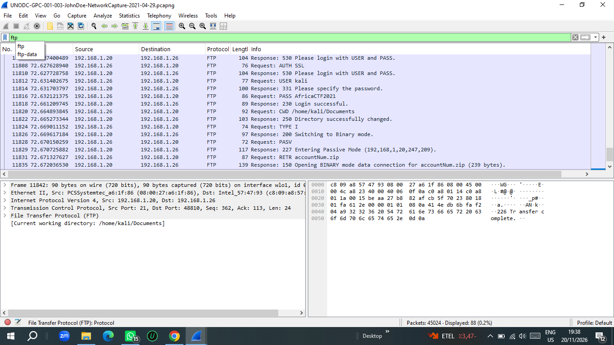

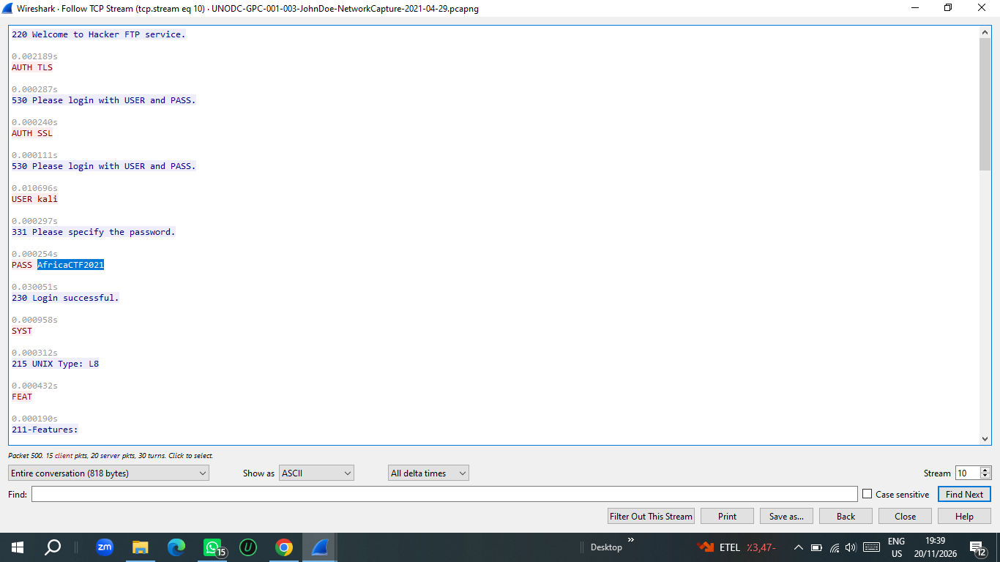

The stream shows the server banner `220 Welcome to Hacker FTP service.`, the client trying `AUTH TLS` and `AUTH SSL` (both rejected with `530`), and then logging in with the plaintext credentials `USER kali` / `PASS AfricaCTF2021`.

**Answer:** `AfricaCTF2021`

---

### Q2: What is the IPv6 address of the DNS server used by 192.168.1.26?

DNS translates domain names to IP addresses. To find which server a client talks to, isolate its DNS queries and look at the destination.

**Steps**

1. Apply the filter `dns`.
2. Select a query sent by the host under investigation and expand **Internet Protocol Version 6**.

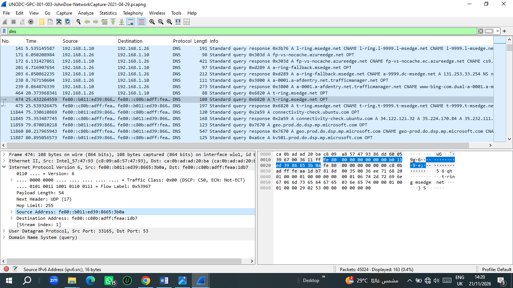

The client sends queries from its link-local address `fe80::b011:ed39:8665:3b0a` to the DNS server at `fe80::c80b:adff:feaa:1db7`. This is a **link-local** address (`fe80::/10`): it is only valid on the local network segment and is not globally routable. Notice also that the Ethernet source MAC of these IPv6 frames is the same Intel NIC found in Q5, which ties the IPv6 and IPv4 activity to one machine.

**Answer:** `fe80::c80b:adff:feaa:1db7`

---

### Q3: What domain is the user looking up in packet 15174?

DNS queries are a good indicator of user activity. To jump directly to the packet:

```
frame.number == 15174
```

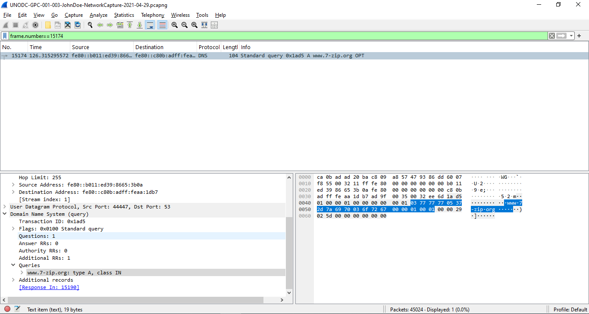

Expanding the **Queries** section of the DNS layer shows a type **A** query (IPv4 address request) for `www.7-zip.org`, the website of the open-source 7-Zip archiver. The client again uses IPv6 here: `fe80::b011:ed39:8665:3b0a` -> `fe80::c80b:adff:feaa:1db7`. The response is in packet 15190.

**Answer:** `www.7-zip.org`

---

### Q4: How many UDP packets were sent from 192.168.1.26 to 24.39.217.246?

UDP is a connectionless transport protocol used for DNS, streaming, VoIP and more. A compound display filter isolates exactly the traffic we want:

```
ip.src == 192.168.1.26 && ip.dst == 24.39.217.246 && udp
```

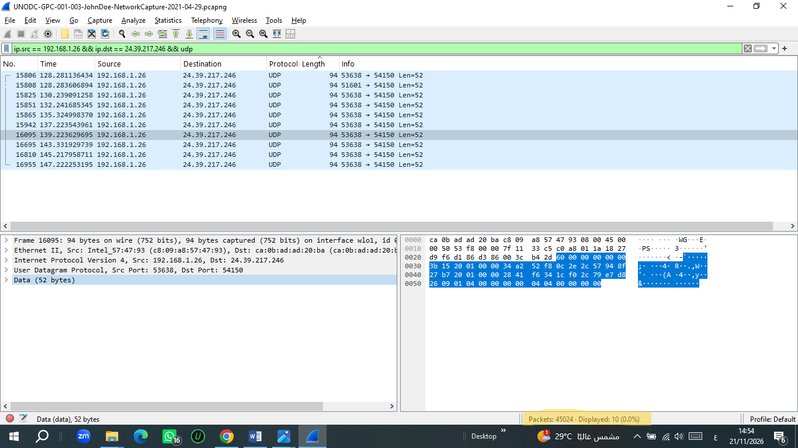

The **Displayed** counter in the bottom-right corner of the Wireshark window shows the number of matching packets.

**Answer:** `10`

---

### Q5: What is the MAC address of the system under investigation?

A MAC address is a hardware-bound identifier at the **data link layer (Layer 2)**. It is present in every Ethernet frame, so any packet to or from `192.168.1.26` reveals it. Unlike an IP address, it normally does not change with network configuration.

**Steps**

1. Filter on `ip.src == 192.168.1.26`.
2. Expand **Ethernet II** and read the **Source** field.

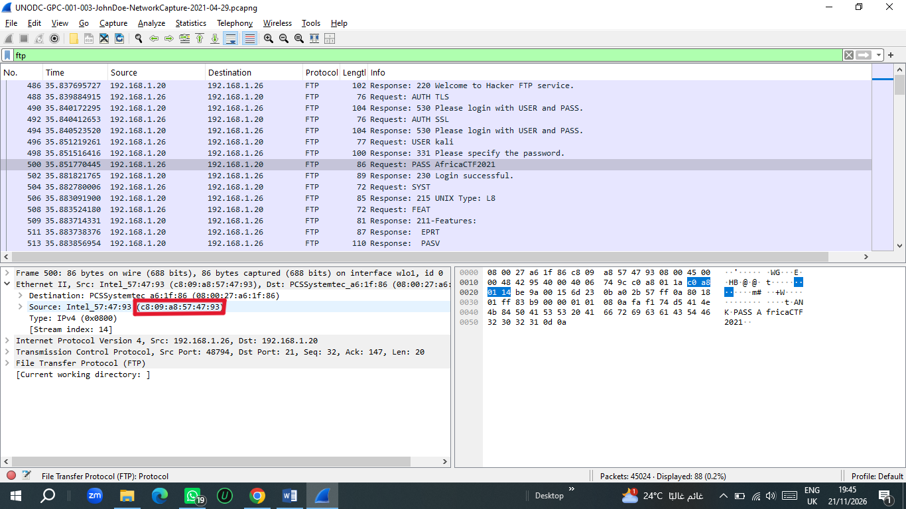

The source MAC is `c8:09:a8:57:47:93`, and Wireshark resolves the vendor prefix to **Intel**.

> **Why it matters:** MAC addresses help with device fingerprinting, tying activity to a specific endpoint, and spotting rogue or unauthorized devices on a network.

**Answer:** `c8:09:a8:57:47:93`

---

### Q6: What camera model was used to take picture `20210429_152157.jpg`?

JPEG files embed **EXIF** metadata: camera make and model, timestamp, GPS (if enabled), exposure settings and more. To read it, we first need to recover the file from the capture.

**Steps**

1. Confirm the transfer with `frame contains "20210429_152157"`.
2. Go to **File > Export Objects > FTP** and save `20210429_152157.jpg`.

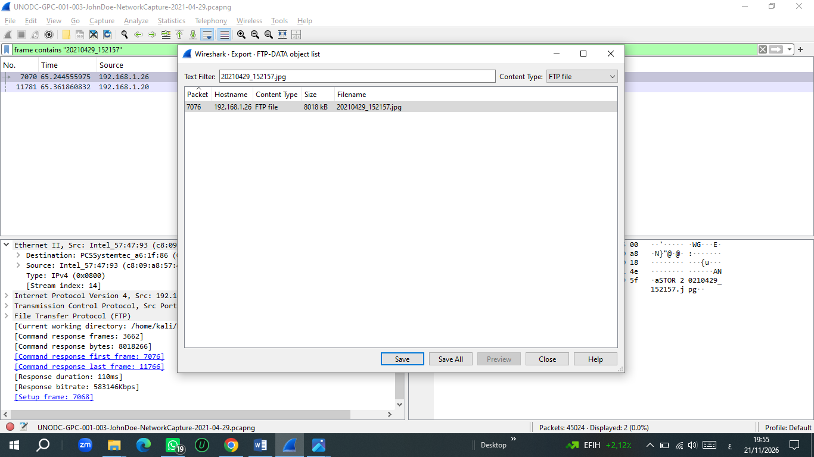

3. Open the saved file's **Properties > Details** tab to read the EXIF data.

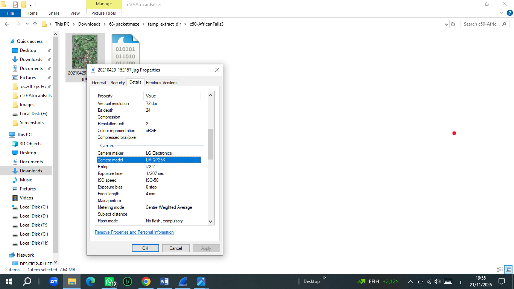

The metadata lists the camera as **LG Electronics LM-Q725K**, an LG smartphone.

> **Why it matters:** EXIF data can link a leaked file to a specific device and person, and show when and where it was created.

**Answer:** `LM-Q725K`

---

### Q7: What is the public key of the server certificate used in the TLS session with session ID `da4a0000342e4b73459d7360b4bea971cc303ac18d29b99067e46d16cc07f4ff`?

TLS provides confidentiality, integrity and authentication. During the handshake the client and server negotiate parameters, the server presents its certificate, and both sides establish shared keys.

Filter by the session ID:

```
tls.handshake.session_id == da4a0000342e4b73459d7360b4bea971cc303ac18d29b99067e46d16cc07f4ff
```

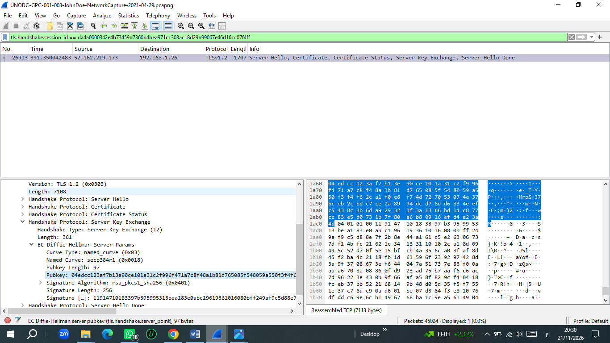

This returns one packet (No. 26913, `52.162.219.173` -> `192.168.1.26`, TLS 1.2: *Server Hello, Certificate, Certificate Status, Server Key Exchange, Server Hello Done*). Under **Server Key Exchange > EC Diffie-Hellman Server Params**, the curve is `secp384r1` and the 97-byte public key is:

```
04edcc123af7b13e90ce101a31c2f996f471a7c8f48a1b81d765085f548059a550f3f4f62ca1f0e8f74d727053074a37bceb2cbdc7ce2a8994dcd76dd6834eefc5438c3b6da929321f3a1366bd14c877cc83e5d0731b7f80a6b80916efd4a23a4d
```

This is the server's ECDH public value. The client combines it with its own private key to derive a shared secret without that secret ever crossing the wire.

**Answer:** the key above.

---

### Q8: What is the first TLS 1.3 Client Random used to connect to protonmail.com?

The **Client Random** is a 32-byte random value sent in the **Client Hello**. Together with the Server Random and the (EC)DHE shared secret, it feeds the key derivation, which guarantees unique session keys for every connection.

Filter Client Hello messages by server name (SNI):

```
tls.handshake.type == 1 && tls.handshake.extensions_server_name == "protonmail.com"
```

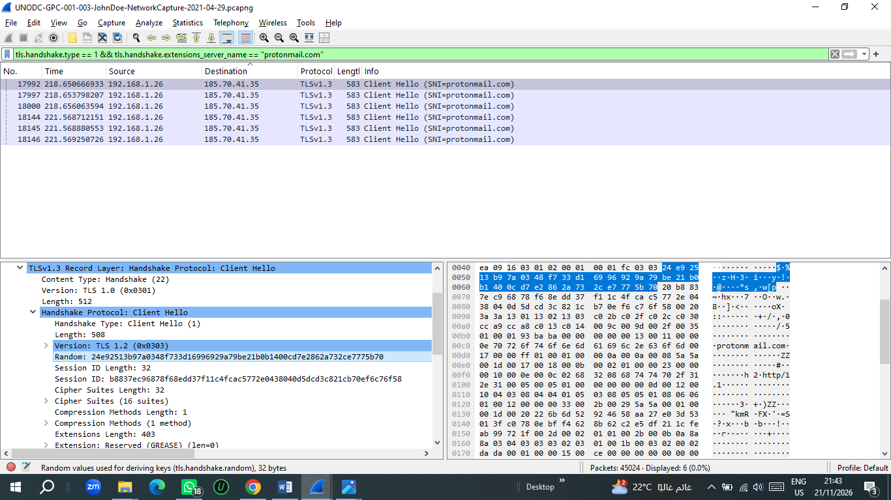

Six Client Hello packets match. The first is packet **17992**. In its **Handshake Protocol: Client Hello** section, the `Random` field is:

```
24e92513b97a0348f733d16996929a79be21b0b1400cd7e2862a732ce7775b70
```

**Answer:** `24e92513b97a0348f733d16996929a79be21b0b1400cd7e2862a732ce7775b70`

---

### Q9: Which country is the FTP server's MAC address registered in?

**Steps**

1. Filter on `ftp` to isolate traffic between the client `192.168.1.26` and the server `192.168.1.20`.
2. Pick a packet **sent by** the server and read the **Ethernet II > Source** MAC.

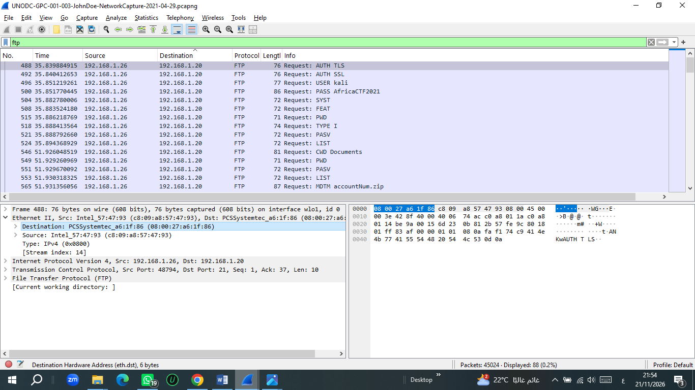

3. Look the MAC up with an OUI lookup tool.

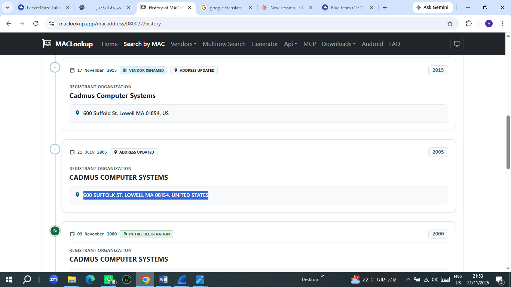

The server's MAC is `08:00:27:a6:1f:86`. The lookup returns **PCS Systemtechnik GmbH**, with a registered address in Lowell, Massachusetts, **United States**.

> **Side note:** the `08:00:27` prefix is the one commonly used by **Oracle VirtualBox** virtual NICs, which suggests the FTP server is a virtual machine. That fits the `kali` account and the `/home/kali` working directory seen in Q10.

**Answer:** `United States`

---

### Q10: What time was a non-standard folder created on the FTP server on the 20th of April?

The FTP `LIST` command returns a directory listing with permissions, owner, size and timestamp. Following the TCP stream of the data connection for the `LIST` response (stream 11) shows the contents of `/home/kali`.

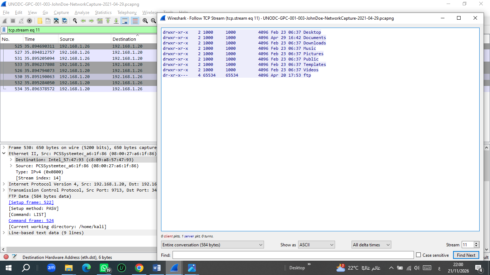

The standard user folders (Desktop, Downloads, Music, Pictures, Public, Templates, Videos) are dated **Feb 23**, and `Documents` was modified on Apr 29. One entry does not belong to the default set:

```
dr-xr-x---  4 65534 65534  4096 Apr 20 17:53 ftp
```

The `ftp` folder carries an **Apr 20, 17:53** timestamp, owned by UID/GID 65534 (`nobody`) with restricted permissions. A manually created folder like this can indicate staging of files for storage or exfiltration. (Strictly speaking, `ls`-style listings show the last modification time rather than a creation time, but this is the value the question asks for.)

**Answer:** `17:53`

---

### Q11: What URL was visited by the user and connected to the IP address 104.21.89.171?

HTTP is plaintext, so requested URLs are directly readable:

```
ip.addr == 104.21.89.171 && http
```

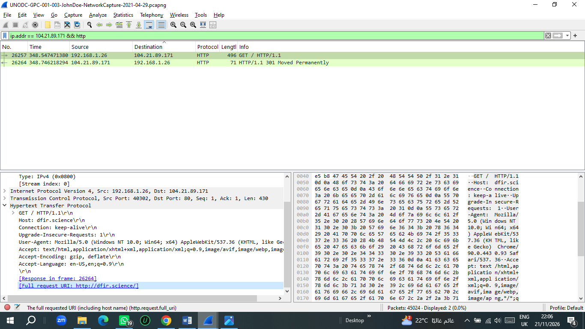

Packet 26257 is a `GET /` request with `Host: dfir.science`, and Wireshark's **Full request URI** field shows `http://dfir.science/`. The server replied in packet 26264 with **HTTP 301 Moved Permanently**, most likely redirecting the client to the HTTPS version of the site.

**Answer:** `http://dfir.science/`

---

## Indicators and Key Artifacts

| Type | Value | Notes |
|---|---|---|
| Victim host (IPv4) | `192.168.1.26` | Source of the investigated activity |
| Victim host (MAC) | `c8:09:a8:57:47:93` | Intel NIC |
| Victim host (IPv6, link-local) | `fe80::b011:ed39:8665:3b0a` | Same MAC as the IPv4 traffic |
| FTP server | `192.168.1.20` / `08:00:27:a6:1f:86` | Likely a VirtualBox VM (PCS Systemtechnik OUI) |
| FTP credentials | `kali` / `AfricaCTF2021` | Sent in plaintext |
| DNS server (link-local IPv6) | `fe80::c80b:adff:feaa:1db7` | Used by the victim host |
| Transferred file | `20210429_152157.jpg` | EXIF camera: LG LM-Q725K |
| Suspicious folder | `ftp` (Apr 20 17:53) | Non-standard folder in `/home/kali` |
| TLS destination | `185.70.41.35` (protonmail.com) | TLS 1.3 sessions |
| HTTP destination | `104.21.89.171` (`dfir.science`) | 301 redirect to HTTPS |

## Wireshark Filter Cheat Sheet

| Goal | Filter |
|---|---|
| Show FTP traffic | `ftp` |
| Show DNS traffic | `dns` |
| Jump to a packet | `frame.number == 15174` |
| UDP from host A to host B | `ip.src == A && ip.dst == B && udp` |
| Search packet contents | `frame contains "string"` |
| TLS session by ID | `tls.handshake.session_id == <id>` |
| TLS Client Hello by SNI | `tls.handshake.type == 1 && tls.handshake.extensions_server_name == "<host>"` |
| HTTP for a given IP | `ip.addr == <ip> && http` |

## Key Takeaways

- **Plaintext protocols leak everything.** The FTP login and every transferred file, including an image with revealing EXIF data, were fully recoverable from the capture.
- **Metadata is evidence.** MAC addresses, EXIF fields, directory timestamps and DNS queries each added context about the device, the user and their activity.
- **Even encrypted traffic leaves artifacts.** TLS handshakes expose server names (SNI), session IDs, client randoms and key-exchange parameters that help correlate sessions.

## Recommendations

- Replace FTP with **SFTP or FTPS** and disable plaintext authentication.
- Do not use weak or guessable passwords for services exposed on the network.
- Monitor for unexpected outbound connections and unusual directories on servers.
- Strip EXIF metadata from images before they are stored or shared.

## Conclusion

By working through each protocol in the capture, I identified the compromised host, recovered credentials and a transferred file, fingerprinted the devices involved, and traced the user's DNS, TLS and HTTP activity. The investigation shows how much a defender can reconstruct from a single PCAP when plaintext protocols and misconfigurations are in play.
